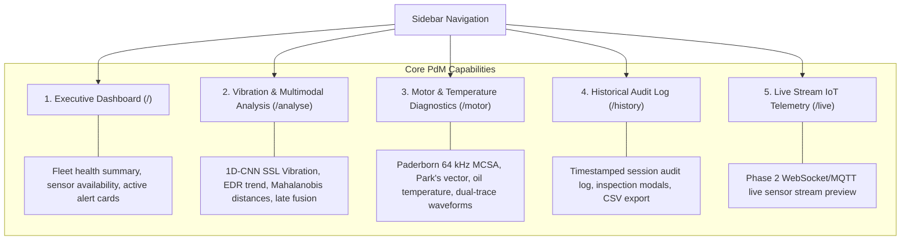

# Web Application Dashboard & Visualisation Guide
## Complete Guide to Every Page, Graph, Metric, and Workflow

**Project Title**: IoT-Based Predictive Maintenance Using Self-Supervised Learning and Bearing Fault Detection  
**Frontend URL**: [http://localhost:5173](http://localhost:5173)  
**Backend API**: [http://localhost:8000](http://localhost:8000) (Swagger Docs: [http://localhost:8000/docs](http://localhost:8000/docs))  
**Target Hardware / Benchmarks**: CWRU Bearing Vibration (12/48 kHz), Paderborn University Stator Current & Temp (64 kHz), MIMII Acoustic Sound (16 kHz)

---

## Table of Contents
1. [Overview & Navigation Architecture](#1-overview--navigation-architecture)
2. [Executive Dashboard Page (`/`)](#2-executive-dashboard-page-)
3. [Vibration & Multimodal Analysis Page (`/analyse`)](#3-vibration--multimodal-analysis-page-analyse)
4. [Motor Current & Temperature Diagnostics Page (`/motor`)](#4-motor-current--temperature-diagnostics-page-motor)
5. [Analysis History & Audit Log Page (`/history`)](#5-analysis-history--audit-log-page-history)
6. [Live Streaming & IoT Ingestion Preview (`/live`)](#6-live-streaming--iot-ingestion-preview-live)
7. [Comprehensive Graph & Visualisation Encyclopedia](#7-comprehensive-graph--visualisation-encyclopedia)
8. [Faculty / Examiner Demo Walkthrough (Step-by-Step)](#8-faculty--examiner-demo-walkthrough-step-by-step)

---

## 1. Overview & Navigation Architecture

The web application is structured into four primary operational views and one live streaming view:



---

## 2. Executive Dashboard Page (`/`)

### Purpose
The **Executive Dashboard** provides high-level situational awareness across all monitored industrial machinery. It acts as the central operations console where plant engineers can immediately see machine status without digging into low-level raw signals.

### Key Sections & Cards

| UI Element | What It Displays | How to Interpret It |
| :--- | :--- | :--- |
| **Fleet Health Status** | Top metric card showing system health (e.g., `HEALTHY`, `DEGRADED`, or `ALARM`). | Aggregates all sensor modalities. If any subsystem flags an anomaly, status transitions to `WARNING` or `ALARM`. |
| **Multimodal Consensus Gauge** | Consolidated confidence score (%) and overall anomaly ratio. | Weighted consensus across vibration, motor current, and acoustic models. |
| **Subsystem Health Cards** | 3 modular cards: **Vibration SSL (CWRU)**, **Motor & Thermal (Paderborn)**, and **Acoustic Autoencoder (MIMII)**. | Shows whether checkpoints are loaded (`ONLINE`), unavailable (`OFFLINE`), or missing data (`NOT PROVIDED`). |
| **Recent Telemetry Stream** | Mini waveform preview of incoming telemetry. | Shows whether the sensor feed is live or replaying benchmark recordings. |
| **Active Alerts Drawer** | Real-time notifications of detected bearing or motor faults. | Displays timestamp, machine ID, affected subsystem, and severity. |

---

## 3. Vibration & Multimodal Analysis Page (`/analyse`)

### Purpose
The **Analyse Page** is the diagnostic laboratory for vibration analysis and late sensor consensus fusion. It allows engineers to upload new vibration files or replay CWRU benchmark recordings to perform self-supervised anomaly detection and fault classification.

### Workflow & Tabs
The page contains 4 operational tabs:
1. **Multimodal Late Fusion Tab**: Fuses Vibration + Motor + Acoustic into an authoritative verdict.
2. **Vibration Tab**: Evaluates CWRU 12/48 kHz acceleration signals using the frozen 1D-CNN encoder and HealthMonitor.
3. **Sound Tab**: Evaluates acoustic clips using the Dense Autoencoder (when audio data is present).
4. **Motor Tab**: Integrated motor current & temperature analyzer.

---

### Detailed Breakdown of Vibration Visualisations

#### 1. Raw Acceleration Waveform Chart
- **What It Represents**: The instantaneous mechanical acceleration of the motor housing recorded by the Drive-End (DE) or Fan-End (FE) accelerometer.
- **X-Axis**: Time in seconds ($0\text{ to }10\text{ s}$).
- **Y-Axis**: Acceleration in standard gravity units ($g = 9.81\text{ m/s}^2$).
- **Visual Interpretation**:
  - **Healthy Bearing**: Low-amplitude, uniform random noise ($|g| < 0.2\text{ g}$).
  - **Faulty Bearing (Outer Race / Inner Race)**: High-amplitude, sharp periodic impact spikes exceeding $2.0\text{ g}$ occurring each time a rolling ball strikes the micro-spall defect.

#### 2. EDR Anomaly Trend Monitoring Graph
- **What It Represents**: **Energy-Normalized Relative Entropy Rate (EDR)** computed across sliding temporal windows:
  $$\text{EDR}_t = \frac{D_{\text{KL}}(p_t \parallel q)}{T_{\text{window}}} \quad [\text{nats / second}]$$
  where $q$ is the healthy baseline Gaussian distribution in 128-D latent space and $p_t$ is the current window distribution.
- **X-Axis**: Time along the degradation timeline (seconds).
- **Y-Axis**: EDR score in nats/s (logarithmic scale).
- **Dashed Red Line**: Anomaly Decision Threshold ($\tau = \mu_{\text{healthy}} + 3\sigma_{\text{healthy}}$).
- **Visual Interpretation**:
  - **Points below threshold**: Signal is operating within normal physical baseline tolerances.
  - **Points crossing above threshold**: Machine has developed an anomaly. The height above the threshold represents degradation severity.

#### 3. Per-Segment Mahalanobis Distance Bar Chart
- **What It Represents**: Squared Mahalanobis distance of individual $0.25\text{ s}$ segments against the healthy latent centroid:
  $$d_{\text{M}}^2 = (z - \mu_{\text{healthy}})^T \Sigma_{\text{healthy}}^{-1} (z - \mu_{\text{healthy}})$$
- **X-Axis**: Segment index ($1\text{ to }N$).
- **Y-Axis**: Squared distance ($d_{\text{M}}^2$).
- **Dashed Black Line**: 99th percentile healthy commissioning threshold.
- **Visual Interpretation**: Shows which specific slices of the recording triggered the anomaly. If only 1 or 2 isolated segments spike, it may be transient electrical noise; if the majority of bars exceed the line, it is a persistent physical defect.

#### 4. Latent Representation Projection (PCA / t-SNE Scatter)
- **What It Represents**: 2D projection of the 128-D self-supervised embeddings extracted by the 1D-CNN encoder.
- **Dots**: Individual signal windows.
  - **Green Dots**: Commissioned healthy baseline clusters.
  - **Colored Dots (Red, Orange, Purple)**: Different fault classes (Inner Race, Ball, Outer Race).
  - **Large Star / Crosshair**: Current sample being analyzed.
- **Visual Interpretation**: Demonstrates contrastive clustering. If the current sample falls inside the green cluster, the bearing is healthy; if it projects into one of the outer fault islands, it is anomalous.

#### 5. 10-Class Downstream Probability Distribution
- **What It Represents**: Softmax output probabilities from the downstream SVM/MLP classifier for CWRU fault categories:
  - `Normal` (Healthy baseline)
  - `IR007`, `IR014`, `IR021` (Inner Race faults of 0.007", 0.014", 0.021" depth)
  - `B007`, `B014`, `B021` (Ball / rolling element defect)
  - `OR007`, `OR014`, `OR021` (Outer Race defects)
- **Visual Interpretation**: Indicates the exact mechanical component failure and its physical severity.

---

### Multimodal Late Fusion Section

#### Consensus Fusion Table
Displays each modality side-by-side:
- **Modality**: Vibration | Motor Current/Temp | Acoustic Sound
- **Status**: `NORMAL` (Green) | `ANOMALOUS` (Red) | `NOT PROVIDED` (Grey)
- **Score Ratio ($S / \tau$)**: Normalized anomaly ratio:
  - Ratio $< 1.0$: Sensor considers the machine healthy.
  - Ratio $\ge 1.0$: Sensor detects an anomaly. (e.g., $1.5\times$ means 50% above threshold).
- **Verdict**:
  - `NORMAL`: All active sensors agree the machine is healthy.
  - `WARNING`: An early-stage anomaly is flagged by one sensor (e.g., stator current or vibration) while others remain borderline.
  - `ALARM`: Multiple sensors confirm an anomaly, or an anomaly ratio exceeds critical thresholds.

---

## 4. Motor Current & Temperature Diagnostics Page (`/motor`)

### Purpose
Dedicated subsystem suite for **Motor Current Signature Analysis (MCSA)** and **Thermal Oil Bath Monitoring** developed on the **Paderborn University (PU) bearing dataset** ($64\text{ kHz}$ dual-phase stator current + oil bath temperature).

```
+------------------------------------------------------------------------------------------------------+
| [Select Benchmark Recording (240)]  [Upload Current & Thermal Data]       Model Mode: [Combined 99%] |
| Filter: [All] [Healthy (K001)] [Outer Race (KA01)] [Inner Race (KI01)]                               |
| Recording File: N15_M07_F04_KA01_1.mat — KA01 (Outer_Race, 1500 RPM, 0.7 Nm)     [ Analyse Motor Data ]|
+------------------------------------------------------------------------------------------------------+
| Verdict: ANOMALOUS (Outer Race) | Confidence: 100% | Anomaly Score: 0.148 | Thermal State: 46.0 °C   |
+------------------------------------------------------------------------------------------------------+
| [Dual-Phase Current Waveforms (I_u, I_v)]            [MCSA FFT Spectrum (0 - 1000 Hz)]               |
+------------------------------------------------------------------------------------------------------+
| [Class Probability: Inner Race (0%) | Normal (0%) | Outer Race (100%)]                              |
+------------------------------------------------------------------------------------------------------+
| [Multimodal Feature Diagnostics Table (40 Engineered MCSA, Park's Vector & Thermal Features)]       |
+------------------------------------------------------------------------------------------------------+
```

### Controls & Selectors

1. **Benchmark vs Upload Toggle**:
   - **Select Benchmark Recording (240)**: Instant access to the 240 real Paderborn benchmark files on disk.
   - **Upload Current & Thermal Data**: Drag-and-drop custom `.mat`, `.csv`, or `.npy` telemetry files with an optional temperature override field.
2. **Bearing Filter Pills**:
   - `All Recordings (240)`
   - `Healthy (K001)`: 80 undamaged baseline runs.
   - `Outer Race (KA01)`: 80 artificial electrical discharge machined (EDM) outer ring spall runs.
   - `Inner Race (KI01)`: 80 artificial EDM inner ring spall runs.
3. **Model Mode Selector**:
   - **Combined (Current + Temp) [98.97% Accuracy]**: Recommended default. Utilizes all 40 spectral, time-domain, Park's vector, and thermal features.
   - **Current-Only [98.80% Accuracy]**: Evaluates stator current signatures without temperature input (essential if thermal probes fail).
   - **Temp-Only [52.61% Accuracy]**: Evaluates temperature alone. (Empirically illustrates why temperature alone is ineffective for bearing fault detection).

---

### Detailed Breakdown of Motor Visualisations

#### 1. Instantaneous Dual-Phase Current Waveforms ($I_u, I_v$)
- **What It Represents**: Time-domain electrical current flowing through phase 1 ($I_u$, Blue) and phase 2 ($I_v$, Purple) of the induction motor stator windings.
- **X-Axis**: Time in seconds ($0\text{ to }4.0\text{ s}$).
- **Y-Axis**: Current in Amperes ($\text{A}$).
- **Visual Interpretation**:
  - Two sinusoidal waves with a nominal $120^\circ$ electrical phase shift.
  - Symmetrical sinusoidal currents indicate balanced motor operation.
  - Any amplitude modulation or distortion in the envelopes indicates mechanical torque ripple induced by bearing defect passes.

#### 2. MCSA Spectral FFT Spectrum ($0\text{ to }1000\text{ Hz}$)
- **What It Represents**: High-resolution Fast Fourier Transform (FFT) of the stator current, showing the electrical supply fundamental frequency and mechanical fault-induced sideband harmonics.
- **X-Axis**: Frequency in Hertz ($\text{Hz}$), zoomed to $0\text{--}1000\text{ Hz}$.
- **Y-Axis**: Single-sided current amplitude in Amperes ($\text{A}$).
- **Visual Interpretation**:
  - **Dominant Peak at $50\text{ Hz}$ (or $30\text{ Hz}$ at $900\text{ RPM}$)**: The fundamental AC electrical supply frequency driving the motor.
  - **Harmonics ($100\text{ Hz}, 150\text{ Hz}, 250\text{ Hz}$)**: Inverter switching harmonics and magnetic saturation.
  - **Characteristic Fault Sidebands ($f_e \pm k \cdot f_{\text{fault}}$)**:
    - Outer race bearing defect frequency (BPFO) modulates the stator current, producing sideband peaks around the fundamental.
    - An elevated sideband energy ratio in this chart directly proves the presence of bearing spalling before the machine physically overheats.

#### 3. Class Probability Distribution Bar
- **What It Represents**: Posterior probability assigned by the Random Forest classifier across the three machine conditions:
  - `Normal` (Green)
  - `Outer Race` (Yellow/Orange)
  - `Inner Race` (Red)
- **Visual Interpretation**: Displays the model's certainty. For example, a $100\%$ bar on Outer Race confirms unequivocal fault detection.

#### 4. Multimodal Feature Diagnostics Table (40 Features)
- **What It Represents**: Complete numerical audit of all engineered features used for the decision:
  - **Phase 1 & Phase 2 Time Domain**: RMS ($I_{\text{rms}}$), Peak ($I_{\text{peak}}$), Peak-to-Peak, Crest Factor ($\frac{I_{\text{peak}}}{I_{\text{rms}}}$), Kurtosis, Skewness, Shape Factor, Impulse Factor, Margin Factor.
  - **Phase 1 & Phase 2 Spectral MCSA**: Fundamental Frequency ($f_e$), Fundamental Amplitude ($A_e$), Total Harmonic Distortion (THD), Sideband Energy Ratio, Spectral Centroid, Spectral Entropy.
  - **Park's Vector Transform**: $\text{Park Mean}$, $\text{Park Std}$, $\text{Park Peak-to-Peak}$, $\text{Park Eccentricity}$ (quantifies circular trajectory distortion caused by phase imbalance).
  - **Thermal State**: $\text{Temp Mean}$, $\text{Temp Min}$, $\text{Temp Max}$, $\text{Temp Std}$, $\text{Temp Slope}$ ($\Delta T / \Delta t$).

---

## 5. Analysis History & Audit Log Page (`/history`)

### Purpose
Provides a non-volatile, timestamped audit log of every diagnostic inference run performed by users during the session.

### Features & Capabilities
1. **Filtering by Modality**: Quick-filter entries by `Vibration`, `Motor`, `Sound`, or `Multimodal Fusion`.
2. **Filtering by Verdict**: Isolate `Normal`, `Warning`, or `Alarm` events.
3. **Replay vs Live Indicators**: Clear badges distinguishing historical benchmark replays from custom file uploads.
4. **Modal Detail Inspection**: Clicking any row opens a JSON viewer showing full model outputs, raw feature values, and timestamps.
5. **CSV Export**: One-click download of the complete audit log for maintenance reporting.

---

## 6. Live Streaming & IoT Ingestion Preview (`/live`)

### Purpose
Demonstrates the **Phase 2 architectural bridge**: how live edge microcontrollers (ESP32 with SCT-013 non-invasive current clamps, DS18B20 digital temperature sensors, and ADXL345 accelerometers) stream telemetry via MQTT/WebSockets into the backend.

### Features
- Simulated live WebSocket heartbeat indicator.
- Rolling window buffer displaying live updates every $500\text{ ms}$.
- Real-time threshold boundary triggering without manual page reloads.

---

## 7. Comprehensive Graph & Visualisation Encyclopedia

This reference table summarizes every visual chart across the entire platform:

| Graph / Chart Title | Page Location | Physics / Signal Metric Represented | Ideal Healthy Appearance | Degradation / Fault Appearance |
| :--- | :--- | :--- | :--- | :--- |
| **Acceleration Waveform** | `/analyse` | Surface vibration acceleration ($g$) vs time ($s$). | Low noise band ($< 0.2\text{ g}$), zero periodic spikes. | Repetitive impact shock pulses ($> 2.0\text{ g}$). |
| **EDR Anomaly Trend** | `/analyse` | Latent relative entropy rate ($\text{nats/s}$) vs time. | Score remains steady well below dashed red threshold. | Trendline ramps upward, crossing threshold into alarm. |
| **Mahalanobis Distances** | `/analyse` | Distance ($d_{\text{M}}^2$) of each segment to healthy center. | All bars below horizontal dashed 99th percentile line. | Multiple consecutive bars spike well above threshold. |
| **Latent Space Scatter** | `/analyse` | 2D PCA/t-SNE projection of 128-D SSL embeddings. | Sample star sits inside dense green healthy cluster. | Sample star projects into separated outer fault clusters. |
| **Fault Class Distribution** | `/analyse` | Softmax probability across 10 CWRU bearing fault sizes. | `Normal` bar at $\ge 90\%$; all fault bars near $0\%$. | Fault class (e.g. `OR007@6`) rises to dominate probability. |
| **Dual Phase Currents ($I_u, I_v$)** | `/motor` | Instantaneous current ($\text{A}$) vs time ($s$). | Symmetrical sine waves with exact $120^\circ$ phase shift. | Amplitude modulation and distortion in sine wave envelope. |
| **MCSA Spectral FFT** | `/motor` | Frequency spectrum ($\text{Hz}$) vs current magnitude ($\text{A}$). | Clean fundamental spike at $50\text{ Hz}$; clean noise floor. | Distinct sideband clusters around fundamental frequency. |
| **Motor Class Probability** | `/motor` | Posterior probability for Normal, Outer Race, Inner Race. | `Normal` bar at $100\%$; fault bars at $0\%$. | `Outer_Race` or `Inner_Race` bar spikes to $90\text{--}100\%$. |
| **Thermal Housing State** | `/motor` | Housing lubricant temperature in $^\circ\text{C}$. | Stable nominal operating temperature ($40\text{--}46^\circ\text{C}$). | Slow thermal climb ($> 65^\circ\text{C}$) in late-stage friction. |

---

## 8. Faculty / Examiner Demo Walkthrough (Step-by-Step)

Follow this exact sequence during project demonstrations to showcase the robustness of your system:

### Demo 1: Motor Normal Baseline (Paderborn K001)
1. Navigate to **Motor & Temp** (`/motor`).
2. Click **Healthy (K001)** filter button.
3. Select `N15_M07_F10_K001_1.mat — K001 (Normal, 1500 RPM, 0.7 Nm)`.
4. Click **Analyse Motor Data**.
5. **Expected Output**:
   - Verdict: **`CONDITION: NORMAL`**
   - Predicted Class: **`Normal`** (Confidence: $\approx 83\text{--}100\%$)
   - Anomaly Score: **`0.13`** (Well below $0.500$ threshold)
   - Waveforms: Clean dual-phase sinusoids with $120^\circ$ phase shift.
   - Spectrum: Clean $50\text{ Hz}$ supply peak with no sidebands.

### Demo 2: Motor Outer Race Fault (Paderborn KA01)
1. On `/motor`, click **Outer Race (KA01)** filter button.
2. Select `N15_M07_F04_KA01_1.mat — KA01 (Outer_Race, 1500 RPM, 0.7 Nm)`.
3. Click **Analyse Motor Data**.
4. **Expected Output**:
   - Verdict: **`ANOMALOUS`** (Red pill)
   - Predicted Class: **`Outer_Race`** (Confidence: **`100.0%`**)
   - Class Probability: **`Outer Race: 100%, Normal: 0%, Inner Race: 0%`**
   - MCSA Spectrum: Notice the sideband modulation around the $50\text{ Hz}$ electrical carrier peak.

### Demo 3: Motor Model Mode Ablation Study
1. On the same Outer Race file, switch **Model Mode** in the top right:
   - Click **Current Only**: Observes that accuracy remains **`100%`** (stator current alone captures bearing fault harmonics).
   - Click **Temp Only**: Observes that temperature alone drops to low confidence, proving why MCSA current analysis is the true early-warning sensor while temperature is a lagging symptom.

### Demo 4: Multimodal Late Consensus Fusion
1. Navigate to **Analyse** (`/analyse`).
2. On the **Multimodal Late Fusion** tab:
   - Select Vibration Recording: `98.mat (Normal)`
   - Select Motor Sample: `paderborn_demo_normal (Normal)`
   - Sound shows: `not provided` (demonstrating graceful degradation without crashing).
3. Click **Run Multimodal Fusion**.
4. **Expected Output**: Fused Verdict shows **`NORMAL`** with low anomaly ratios on both active channels.
