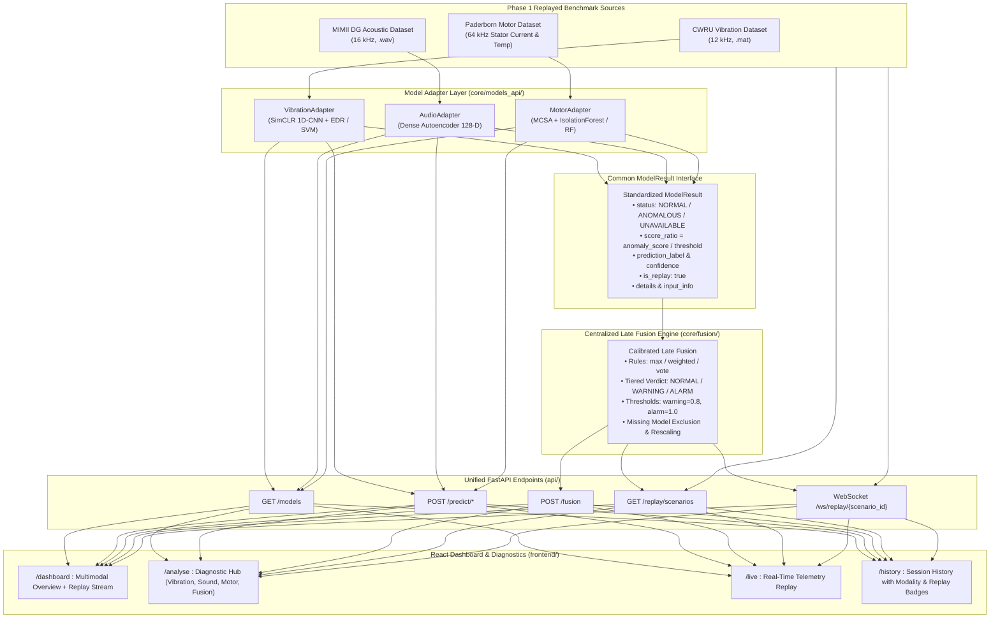

# Phase 1 Design — Self-Supervised Vibration Analytics for Predictive Maintenance

**Reference paper:** Rajagopal M., Shashank R., Shreeshanth R., *"Self-Supervised Vibration Analytics for
Predictive Maintenance of Multistage Compressors"*, Journal of Vibration Engineering & Technologies,
vol. 14, art. 227 (2026), DOI `10.1007/s42417-026-02455-2`.

**Phase 1 = AI/ML software validation only.** No ESP32, no MQTT, no accelerometer, no real-time
acquisition. Those belong to Phase 2, but the Phase 1 interfaces are designed so that a live sensor
stream can replace the offline dataset without touching the model code.

---

## 1. Proposed architecture

```
                    ┌──────────────────────────────────────────────┐
                    │  DATA SOURCE (swappable interface)           │
                    │  Phase 1: CWRU .mat files on disk            │
                    │  Phase 2: MQTT / serial stream from ESP32    │
                    └───────────────────────┬──────────────────────┘
                                            │  raw 1-D vibration signal + metadata
                                            ▼
        ┌────────────────────────────────────────────────────────────────────┐
        │  PREPROCESSING  (preprocessing/)                                   │
        │  load_signal → filter_signal → downsample_signal →                 │
        │  segment_signal (sliding window, configurable overlap) →           │
        │  normalize_signal (per-window z-score)                             │
        └───────────────────────────────┬────────────────────────────────────┘
                                        │  segments  (N, 1, L)
                        ┌───────────────┴────────────────┐
                        │                                │
                        ▼                                ▼
        ┌────────────────────────────┐      ┌──────────────────────────────┐
        │  AUGMENTATION (2 views)    │      │  BASELINE: supervised 1D CNN │
        │  jitter / scaling /        │      │  (labels used directly)      │
        │  time-mask / permutation / │      └──────────────┬───────────────┘
        │  time-shift                │                     │
        └─────────────┬──────────────┘                     │
                      │ view A, view B (NO labels used)    │
                      ▼                                    │
        ┌────────────────────────────────────────┐         │
        │  SIAMESE CONTRASTIVE MODEL (models/)   │         │
        │   shared 1D-CNN encoder  f(·)          │         │
        │   projection head        g(·)          │         │
        │   NT-Xent (InfoNCE) loss               │         │
        └─────────────┬──────────────────────────┘         │
                      │ pretrained encoder (head discarded)│
                      ▼                                    │
        ┌────────────────────────────────────────┐         │
        │  EMBEDDINGS  h = f(x) ∈ R^128          │         │
        │  cached to results/embeddings/         │         │
        └───┬──────────────┬──────────────┬──────┘         │
            │              │              │                │
            ▼              ▼              ▼                ▼
   ┌────────────────┐ ┌──────────┐ ┌───────────────┐ ┌──────────────┐
   │ t-SNE / UMAP   │ │ EDR-style│ │ SVM-RBF / MLP │ │  metrics &   │
   │ visualization  │ │ anomaly  │ │ on 1/5/10/20% │ │  comparison  │
   │                │ │ detection│ │ of the labels │ │              │
   └────────────────┘ └──────────┘ └───────────────┘ └──────────────┘
                              │                │
                              └────────┬───────┘
                                       ▼
                        ┌──────────────────────────────┐
                        │  STREAMLIT DASHBOARD         │
                        │  status / fault / confidence │
                        │  anomaly + EDR trend         │
                        │  embedding map               │
                        └──────────────────────────────┘
```

**Why this shape.** The self-supervised stage never sees a label, so it can consume the whole
(unlabelled) corpus. Only the small downstream head consumes labels. That is exactly the industrial
situation the paper targets: abundant unlabelled vibration, scarce labelled faults.

---

## 2. Exact Phase 1 modules

| Module | File | Responsibility |
| --- | --- | --- |
| Global config | `config.py` | All hyperparameters, paths, seeds in one dataclass-based place |
| Dataset download | `preprocessing/download_cwru.py` | Fetches the CWRU `.mat` files listed in a manifest |
| Loader | `preprocessing/loader.py` | `load_signal()`, CWRU `.mat` parsing, record metadata, file-level inventory |
| Exploration | `preprocessing/explore.py` | Sample counts, classes, fs, lengths, class distribution, sample plots |
| Filtering | `preprocessing/filtering.py` | `filter_signal()` (band-pass/high-pass, Butterworth, zero-phase), `downsample_signal()` |
| Segmentation | `preprocessing/segmentation.py` | `segment_signal()` sliding window + overlap, `normalize_signal()` z-score |
| Augmentation | `preprocessing/augmentation.py` | `augment_signal()`, jitter, scaling, time-mask, permutation, shift, 2-view generator |
| Dataset builder | `preprocessing/build_dataset.py` | Raw → `data/processed/*.npz` with `record_id` kept per segment (leak-free splits) |
| Encoder | `models/encoder.py` | 1-D CNN encoder, configurable depth/width, GAP → `embedding_dim` |
| Siamese | `models/siamese.py` | Shared encoder + projection head, NT-Xent loss |
| Classifier | `models/classifier.py` | SVM-RBF and small MLP on frozen embeddings |
| Baseline | `models/baseline_cnn.py` | Same encoder trunk + supervised softmax head |
| SSL training | `training/train_ssl.py` | Contrastive pretraining loop, checkpoints, loss curves |
| Downstream | `training/train_classifier.py` | Label-fraction sweep (1/5/10/20%), saves metrics |
| Baseline training | `training/train_baseline.py` | Supervised CNN on the same label fractions |
| Splits | `training/splits.py` | Record-level (file-level) train/val/test split — no window leakage |
| EDR | `anomaly_detection/edr.py` | Entropy Divergence Rate approximation (KL between embedding distributions) |
| Detector | `anomaly_detection/anomaly_detector.py` | Healthy baseline fit, thresholding, streaming trend API |
| Metrics | `evaluation/metrics.py` | Accuracy / precision / recall / F1 / confusion matrix |
| Plots | `evaluation/visualization.py` | Loss curves, t-SNE, UMAP, confusion matrices, EDR trend |
| Orchestration | `evaluation/evaluate.py` | Runs the full comparison, writes `results/metrics/*.json` |
| Dashboard | `dashboard/app.py` | Streamlit machine-health monitor |
| Notebooks | `notebooks/01..04` | Narrative versions of each stage for the viva |

---

## 3. Dataset recommendation

**Primary: CWRU Bearing Data Center dataset.** Reasons:

1. The reference paper itself validates on "an adapted CWRU bearing dataset", so it is the directly
   comparable public benchmark.
2. It is small enough to run end-to-end on a laptop CPU, but has a clean factorial structure:
   fault location (inner race / ball / outer race) × fault diameter (0.007–0.028") × motor load
   (0–3 HP) × sampling rate (12 kHz and 48 kHz drive-end).
3. Its labels are *real* dataset labels, so nothing has to be invented. We keep CWRU's own naming:
   `Normal`, `IR` (inner race), `B` (ball), `OR@3`, `OR@6`, `OR@12` (outer-race, by clock position),
   each with its fault diameter.
4. The "healthy baseline vs. degraded" structure needed for EDR exists naturally: the Normal
   baseline files give the healthy reference distribution.

**Path configurability.** Everything goes through `config.DATA_RAW_DIR` / `config.DATA_PROCESSED_DIR`
and a dataset-registry function, so swapping to MAFAULDA, Paderborn, MIMII, or a Phase 2 live stream
means writing one new loader, not editing the pipeline.

**Caveat to state openly in the report:** CWRU is a *bearing test rig*, not a multistage compressor.
We are validating the method, not the paper's in-house compressor result. The paper's six-month
in-house compressor dataset is not public and cannot be used by us.

---

## 4. Final folder structure

```
vibration-ssl-pdm/
├── config.py
├── requirements.txt
├── README.md
├── DESIGN.md
├── data/
│   ├── raw/                 # downloaded CWRU .mat files (git-ignored)
│   └── processed/           # segmented/normalized .npz (git-ignored)
├── preprocessing/
│   ├── __init__.py
│   ├── download_cwru.py
│   ├── loader.py
│   ├── explore.py
│   ├── filtering.py
│   ├── segmentation.py
│   ├── augmentation.py
│   └── build_dataset.py
├── models/
│   ├── __init__.py
│   ├── encoder.py
│   ├── siamese.py
│   ├── classifier.py
│   └── baseline_cnn.py
├── training/
│   ├── __init__.py
│   ├── splits.py
│   ├── train_ssl.py
│   ├── train_classifier.py
│   └── train_baseline.py
├── anomaly_detection/
│   ├── __init__.py
│   ├── edr.py
│   └── anomaly_detector.py
├── evaluation/
│   ├── __init__.py
│   ├── metrics.py
│   ├── visualization.py
│   └── evaluate.py
├── dashboard/
│   └── app.py
├── notebooks/
│   ├── 01_data_exploration.ipynb
│   ├── 02_preprocessing.ipynb
│   ├── 03_ssl_training.ipynb
│   └── 04_evaluation.ipynb
├── checkpoints/             # saved model weights (git-ignored)
└── results/
    ├── figures/
    ├── metrics/
    └── embeddings/
```

---

## 5. Implementation roadmap

| Step | Deliverable | Runnable check |
| --- | --- | --- |
| 1 | Dataset download + loader + exploration | `python -m preprocessing.explore` prints inventory, writes `results/metrics/dataset_summary.json` and sample-signal figures |
| 2 | Filtering, downsampling, segmentation, normalization | `python -m preprocessing.build_dataset` writes `data/processed/segments.npz` |
| 3 | Augmentations + 2-view generator | unit-style script prints shapes and plots original vs. two views |
| 4 | 1-D CNN encoder | forward-pass shape test `(B,1,L) → (B,128)` |
| 5 | Siamese + NT-Xent pretraining | `python -m training.train_ssl` → checkpoint + loss curve |
| 6 | Embedding extraction | `results/embeddings/*.npz` |
| 7 | t-SNE / UMAP | figures in `results/figures/` |
| 8 | EDR + anomaly detector | anomaly scores + trend figure |
| 9 | SVM / MLP on 1/5/10/20 % labels | `results/metrics/downstream.json` |
| 10 | Supervised 1-D CNN baseline | `results/metrics/baseline.json` |
| 11 | Evaluation + comparison tables/figures | `python -m evaluation.evaluate` |
| 12 | Streamlit dashboard | `streamlit run dashboard/app.py` |
| 13 | README + notebooks + documentation | — |

Each step is committed only after it actually runs.

---

## 6. What cannot be reproduced from the paper (stated honestly)

1. **The in-house dataset.** Six months of multistage-compressor vibration collected by the authors
   is not public. We substitute CWRU and say so.
2. **The exact EDR formulation.** The abstract defines EDR as a metric capturing *distributional
   shift in the learned feature space*; the full derivation is in the paywalled body, and the PDF
   supplied to us was corrupted and unreadable. Our `anomaly_detection/edr.py` therefore implements a
   **documented approximation**: a KL divergence between a healthy reference distribution and a
   sliding-window current distribution in embedding space, reported per unit time ("rate").
   Two estimators are provided — a multivariate-Gaussian closed form and a histogram/kNN estimator —
   and the module docstring states explicitly that this is *inspired by*, not identical to, the
   paper's EDR.
3. **Exact architecture hyperparameters** (layer count, kernel sizes, batch size, temperature,
   optimiser schedule, augmentation probabilities) are not available to us; we choose standard
   SimCLR-style values and expose them all in `config.py`.
4. **The reported F1 = 0.93 and "28 % improvement in early fault detection"** are the authors'
   numbers on their data. We will measure our own numbers on CWRU and will not claim parity.
5. **Whether the paper's Siamese model uses momentum/BYOL-style targets or plain SimCLR** is unknown;
   we implement plain SimCLR/NT-Xent, which the abstract's "contrastive Siamese" wording supports.

---

## 7. Anti-leakage policy (important for the viva)

Sliding windows with 50 % overlap make neighbouring segments nearly identical. Splitting segments
randomly would let the test set contain near-duplicates of training segments and inflate accuracy.
So: **splits are made at the record (source `.mat` file) level**, and every segment carries its
`record_id`. `training/splits.py` enforces that no record appears in more than one split, and the
split function asserts this.

---

## 8. Multimodal PdM Architecture, Integration & Late Fusion

### 8.1 Unified System Architecture



### 8.2 Standardized Result Contract (`ModelResult`)

All predictive maintenance models adhere to [`BaseModelAdapter`](file:///c:/Main%20Project%20S7/MainProject/vibration-ssl-pdm/core/models_api/interface.py) and output a standardized [`ModelResult`](file:///c:/Main%20Project%20S7/MainProject/vibration-ssl-pdm/core/models_api/interface.py) schema:
- `model_name`: Unique model name.
- `modality`: `"vibration" | "audio" | "motor"`.
- `status`: `"NORMAL" | "ANOMALOUS" | "UNAVAILABLE"`.
- `anomaly_score`: Modality-specific anomaly index (EDR rate in nats/s, audio reconstruction MSE, MCSA anomaly score).
- `threshold`: Pre-calibrated commissioning threshold.
- `score_ratio`: Normalized anomaly index ($r = \text{score} / \text{threshold}$). Anomaly declared when $r \ge 1.0$.
- `prediction_label`: Diagnostic classification (`"Normal"`, `"Outer_Race"`, `"IR007"`, etc.).
- `confidence`: Confidence score in $[0.0, 1.0]$.
- `is_replay`: Flag strictly `True` for recorded benchmark samples.
- `error`: Error string if `status == "UNAVAILABLE"`.

### 8.3 Calibrated Late Fusion Engine

1. **Aggregation Strategies**:
   - `max`: $r_{fused} = \max_i(r_i)$. Conservative, high sensitivity for early safety-critical alarms.
   - `weighted`: $r_{fused} = \sum w_i r_i$. Balances multi-sensor evidence according to sensor quality weights.
   - `vote`: Majority voting rule with tie-breaking on average score ratio.
2. **Decision Boundaries**:
   - `NORMAL`: $r_{fused} < 0.8$.
   - `WARNING`: $r_{fused} \ge 0.8$ or single sensor alert.
   - `ALARM`: $r_{fused} \ge 1.0$ with $\ge 2$ agreeing sensors, or severe single sensor alert ($r_i \ge 2.0$).
3. **Resilience to Missing Modalities**:
   - Unavailable or unprovided sensors are marked `"not provided"`.
   - Denominator weights are rescaled over active sensors only.
   - Overall confidence is penalized proportionally to the missing sensor fraction ($\text{active} / \text{expected}$).

### 8.4 Unified API Endpoints

| Endpoint | Method | Input Parameters | Return Value |
|---|:---:|---|---|
| `/models` | `GET` | None | Catalogue of registered models, thresholds, modalities, and availability |
| `/replay/scenarios` | `GET` | None | 60-second scenario catalog (`healthy_baseline`, `vibration_fault_onset`, etc.) |
| `/predict/vibration` | `POST` | File (`.mat`, `.npy`, `.csv`), `sampling_rate` | Standardized `ModelResult` with EDR anomaly score & classification |
| `/predict/vibration/sample/{id}` | `POST` | `sample_id` | CWRU held-out benchmark inference (`is_replay=true`) |
| `/predict/audio` | `POST` | File (`.wav`), `machine_type` (`fan`/`bearing`) | Acoustic autoencoder reconstruction error, ratio, and frame scores |
| `/predict/audio/sample/{id}` | `POST` | `sample_id` | MIMII DG held-out benchmark inference (`is_replay=true`) |
| `/predict/motor` | `POST` | File (`.csv`/`.mat`), `temperature` | MCSA stator current signature and thermal diagnosis |
| `/predict/motor/sample/{id}` | `POST` | `sample_id` | Paderborn benchmark motor inference (`is_replay=true`) |
| `/fusion` | `POST` | `results` list or `sample_ids` dict, `method` | Unified `FusionResult` (fused status, score, reasons, confidence) |
| `/ws/replay/{scenario_id}` | `WebSocket` | Commands: `pause`, `resume`, `stop`, `set_speed` | 60-second streaming telemetry replay with synchronized multi-sensor frames |

### 8.5 Frontend Diagnostics Pages

| Route | Page | Purpose / Functionality |
|---|---|---|
| `/dashboard` | **Multimodal Dashboard** | Fused status header, 3 model status cards, Recharts score ratio trend, replay controls, unhideable replay banner |
| `/live` | **Live Stream & Replay** | Reuses `/dashboard` for streaming telemetry and playback |
| `/analyse` | **Diagnostic Hub** | Multi-tab analysis: Vibration (CWRU source selector, waveform, EDR, PCA map), Sound (.wav or demo clip), Motor (.csv/.mat or demo preset), and "Analyse with all models" |
| `/motor` | **Motor Current & Temp** | Dedicated MCSA stator current waveforms, dual-phase spectrum, and Park's vector transform |
| `/history` | **Analysis History** | Browser session history with modality badges (`VIBRATION`, `SOUND`, `MOTOR`, `FUSION`) and `REPLAY` tags |
| `*` | **404 Not Found** | 404 handler with return link to `/dashboard` |

### 8.6 Measured Integration Results (`results/integration/e2e_results.json`)

All 5 scenarios simulate 60 seconds of synchronized multi-sensor operations:

| Scenario | Total Steps | Normal | Warning | Alarm | First Onset | Primary Condition |
|---|:---:|:---:|:---:|:---:|:---:|---|
| `healthy_baseline` | 60 | 18 | 42 | 0 | Step 5 | Continuous nominal operation across all modalities |
| `vibration_fault_onset` | 60 | 7 | 13 | 40 | Step 21 | Nominal $\to$ mechanical impact $\to$ outer race fault |
| `audio_fault_onset` | 60 | 7 | 53 | 0 | Step 5 | Nominal $\to$ high-frequency acoustic hiss/rumble |
| `motor_fault_onset` | 60 | 7 | 53 | 0 | Step 5 | Balanced stator current $\to$ phase unbalance & thermal escalation |
| `multi_fault_escalation` | 60 | 5 | 25 | 30 | Step 31 | Thermal warning $\to$ acoustic hiss $\to$ bearing trip |

### 8.7 API Latency Benchmarks (Median & p95)

| Endpoint | Method | Median Latency | 95th-Percentile Latency |
|---|:---:|:---:|:---:|
| `GET /models` | `GET` | **12.32 ms** | 15.29 ms |
| `GET /replay/scenarios` | `GET` | **4.17 ms** | 5.29 ms |
| `POST /predict/vibration/sample/{id}` | `POST` | **31.46 ms** | 37.67 ms |
| `POST /predict/audio/sample/{id}` | `POST` | **66.56 ms** | 106.50 ms |
| `POST /predict/motor/sample/{id}` | `POST` | **44.42 ms** | 59.62 ms |
| `POST /fusion` | `POST` | **6.41 ms** | 9.57 ms |

### 8.8 Phase 2 Hardware Specifications & Deployment Constraints

* **Vibration Sensor Bandwidth (12 kHz)**: Contrastive 1D-CNN encoder and EDR require 12 kHz sampled acceleration data. Low-bandwidth IMUs cannot capture high-frequency bearing impact pulses, and numerical upsampling cannot reconstruct missing harmonics.
* **Acoustic Sensor Bandwidth (16 kHz)**: Autoencoder expects 16 kHz mono audio (.wav) across 128 log-Mel bins.
* **Motor Current Sensor Bandwidth (64 kHz)**: LEM CKSR current transducers with 64 kHz sampling provide the resolution necessary for Park's vector transforms and spectral sideband harmonics ($f_e \pm f_{fault}$).
* **Classifier Scope**: Supervised classifiers know only their trained benchmark classes (the 16 CWRU classes, fan/bearing, normal/inner/outer race). They cannot classify novel defect types on arbitrary new industrial machines without fine-tuning.
* **Anomaly Score Transferability**: Only locally fitted anomaly scores (vibration EDR with healthy baseline fitted during machine commissioning, acoustic reconstruction errors, MCSA feature baselines) transfer across physical installations.

### 8.9 Key Limitations & Disclaimers
1. **Heterogeneous Benchmark Sources**: Vibration data (CWRU bearing test rig), sound data (MIMII DG acoustic benchmark), and motor data (Paderborn motor test bench) originate from three independent physical setups.
2. **Synthetic Timeline Pairing**: Scenarios pair independently recorded test bench segments into a synchronized 60-second replay. They do not represent a single physical machine with all three sensors co-located.
3. **No Live Sensors**: Phase 1 is AI/ML pipeline and software validation. Replayed data is permanently flagged with `is_replay=True` in all API responses and UI banners.
4. **Lab-to-Field Domain Gap**: Clean test rig benchmark data does not guarantee zero-shot transfer to harsh industrial environments without on-site baseline calibration.

