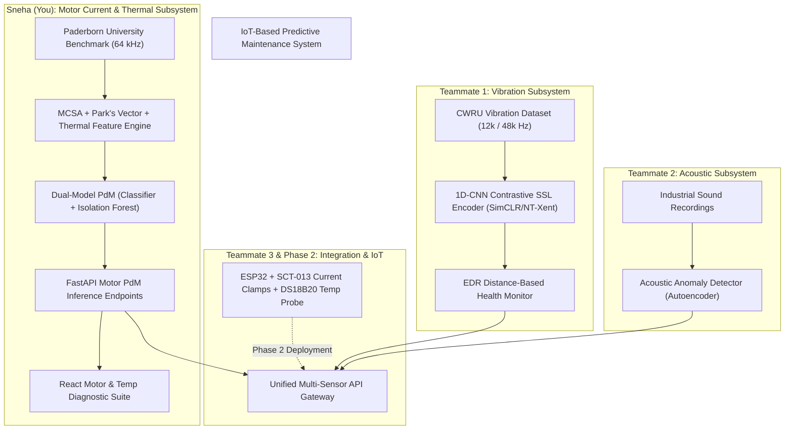
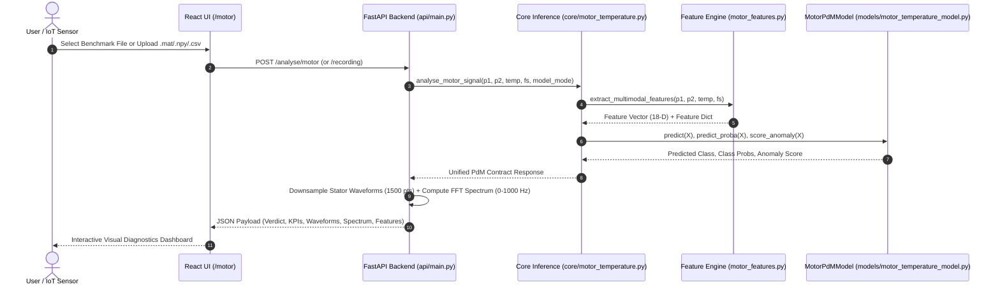

# Motor Current & Temperature Predictive Maintenance Subsystem
## Comprehensive Architecture, Engineering Workflow, and Full-Stack Integration Guide

**Project Title**: IoT-Based Predictive Maintenance Using Self-Supervised Learning and Bearing Fault Detection  
**Phase**: Phase 1 (Algorithmic Modeling, Benchmark Evaluation, API Layer, and Diagnostics UI)  
**Component Responsibility**: Motor Current Signature Analysis (MCSA) & Thermal Baseline Diagnostics  
**Dataset**: Paderborn University Bearing DataCenter (64 kHz Dual-Phase Stator Current + Thermostatically Monitored Oil Bath)

---

## 1. Executive Summary & Team Project Context

This document provides the definitive architectural blueprint, workflow documentation, mathematical foundations, and empirical results for the **Motor Current and Temperature Predictive Maintenance Subsystem** developed for Phase 1 of our final-year engineering project.

### 1.1 Team Division of Responsibilities



### 1.2 Subsystem Isolation & Non-Interference Guarantee
To maintain modularity and respect team boundaries:
1. **Zero Regression on Vibration Pipeline**: All existing CWRU vibration checkpoints (`checkpoints/ssl_encoder.pt`, `checkpoints/health_monitor.joblib`, `checkpoints/baseline_cnn.pt`), data loaders, and tests remain untouched and functional.
2. **Dedicated Checkpoint Storage**: Motor checkpoints are versioned in `checkpoints/motor_temp/` (`combined_model.joblib`, `current_only_model.joblib`, `temperature_only_model.joblib`, `metadata.json`).
3. **Decoupled API Contract**: Standalone inference module `core/motor_temperature.py` exposing `analyse_motor_signal()` returning standardized dictionary structures matching teammate integration specs.
4. **Independent React UI**: Added `/motor` page into the React application with its own navigation entry, full benchmark selector, file uploader, and dual-trace waveform / MCSA spectrum charts.

---

## 2. Benchmark Reality & Physical Modeling Rationale

### 2.1 The Physics of Motor Current Signature Analysis (MCSA)
When a rolling element bearing develops a defect (inner race spalling, outer race pitting, or rolling element flaking):
1. **Mechanical Impact**: As the rolling elements pass over the defect, periodic impact forces generate high-frequency mechanical vibrations at characteristic defect frequencies:
   * **Ball Pass Frequency Outer Race (BPFO)**: $\approx 76\text{ Hz}$ for standard 6203 bearings at 1500 RPM.
   * **Ball Pass Frequency Inner Race (BPFI)**: $\approx 124\text{ Hz}$ for standard 6203 bearings at 1500 RPM.
2. **Air-Gap Permeance Oscillation**: These mechanical impacts cause radial displacement between the motor rotor and stator, creating microscopic air-gap eccentricity oscillations.
3. **Stator Current Modulation**: The rotating magnetic flux interacts with the oscillating air-gap permeance, inducing phase modulation sidebands in the stator current at:
   $$f_{\text{fault}} = |f_e \pm k \cdot f_{\text{bearing}}|$$
   where $f_e$ is the electrical supply frequency ($50\text{ Hz}$) and $f_{\text{bearing}}$ is BPFO or BPFI.
4. **Current Sensor Advantage**: Stator current can be measured non-invasively at the motor control cabinet without installing accelerometers on the motor casing.

### 2.2 The Physics of Bearing Temperature & Benchmark Caveat
* **Operational Fact**: Lessmeier et al. (2016) experimentally regulated lubricant oil temperature to **$45\text{–}50^\circ\text{C}$** across all test bench runs to prevent lubricant viscosity changes from corrupting measurement comparability.
* **Engineering Reality**: Over a 4-second measurement run, temperature is a **slow-moving thermodynamic state variable**, not a cyclic fault indicator. 
* **Methodological Decision**: Contrastive self-supervised neural learning on static scalar temperature values is physically unjustified. Instead, temperature is treated as an **operational health gate and thermal limit baseline**, while MCSA carries high-frequency cyclic fault classification.

---

## 3. End-to-End Processing & Inference Workflow

The end-to-end data pipeline is structured into 6 sequential stages:



---

## 4. Signal Processing & Feature Engineering Mathematics

All features are extracted in `preprocessing/motor_features.py`:

### 4.1 Statistical Time-Domain Metrics
For stator current discrete sequence $x[n], n=0, \dots, N-1$:

| Metric | Mathematical Formula | Physical Significance |
| :--- | :--- | :--- |
| **RMS Current** | $I_{rms} = \sqrt{\frac{1}{N}\sum_{n=0}^{N-1} x[n]^2}$ | Total electrical energy delivered to the stator phase. |
| **Peak Amplitude** | $I_{peak} = \max_n |x[n]|$ | Maximum instantaneous current draw. |
| **Peak-to-Peak** | $I_{p2p} = \max(x) - \min(x)$ | Full dynamic excursion of current oscillation. |
| **Crest Factor** | $CF = \frac{I_{peak}}{I_{rms}}$ | Impulsiveness of current waveform; spikes indicate bearing shocks. |
| **Kurtosis** | $\text{Kurt} = \frac{\frac{1}{N}\sum (x[n] - \mu)^4}{\left(\frac{1}{N}\sum (x[n] - \mu)^2\right)^2}$ | Tail-heaviness of distribution; healthy sinusoidal current $\approx 1.5$. |
| **Skewness** | $\text{Skew} = \frac{\frac{1}{N}\sum (x[n] - \mu)^3}{\sigma^3}$ | Asymmetry of current cycle waveform. |
| **Shape Factor** | $SF = \frac{I_{rms}}{\frac{1}{N}\sum |x[n]|}$ | Departure from ideal sinusoidal waveform geometry. |

### 4.2 Spectral MCSA Metrics (0 – 1000 Hz)
Using single-sided FFT with coherent gain window correction:

| Metric | Mathematical Definition | Purpose |
| :--- | :--- | :--- |
| **Fundamental Supply ($f_0$)** | $f_0 = \arg\max_{f \in [45, 55]} |X(f)|$ | Identifies grid supply frequency ($\approx 50.0\text{ Hz}$). |
| **Total Harmonic Distortion (THD)** | $\text{THD} = \frac{\sqrt{\sum_{k=2}^5 |X(k \cdot f_0)|^2}}{|X(f_0)|}$ | Measures distortion caused by non-linear magnetic saturation and rotor eccentricity. |
| **Sideband Energy Ratio (SER)** | $\text{SER} = \frac{\sum_{f \in [f_0 \pm 100]} |X(f)|^2 - |X(f_0)|^2}{\sum |X(f)|^2}$ | Detects fault-induced sideband energy surrounding fundamental. |
| **Spectral Centroid** | $f_c = \frac{\sum f \cdot |X(f)|}{\sum |X(f)|}$ | Center of mass of power spectrum. |
| **Spectral Entropy** | $H = -\sum p_i \log_2(p_i)$ where $p_i = \frac{|X(f_i)|^2}{\sum |X(f_k)|^2}$ | Measures spectral flatness and white noise content. |

### 4.3 Park's Vector Transform (Two-Phase Current Modulus)
Converts Phase 1 current $i_u$ and Phase 2 current $i_v$ into orthogonal direct-quadrature $(d, q)$ coordinates:
$$i_d = \sqrt{\frac{2}{3}} i_u - \frac{1}{\sqrt{6}} i_v$$
$$i_q = \frac{1}{\sqrt{2}} i_v$$
Park's Vector Modulus:
$$I_p[n] = \sqrt{i_d[n]^2 + i_q[n]^2}$$
In an ideal symmetrical healthy motor, $I_p$ is a perfect constant circle. When bearing fault causes rotor deflection, $I_p$ oscillates:
* **$I_p$ Mean**: Baseline magnetic flux density.
* **$I_p$ Standard Deviation**: Modulus ripple amplitude.
* **Park Eccentricity**: Elliptical distortion ratio of the $(d, q)$ trajectory.

### 4.4 Thermal State Features
* **Mean Temperature**: $\bar{T} = \frac{1}{M}\sum T_m$
* **Standard Deviation**: $\sigma_T$
* **Thermal Drift Slope**: Slope $m$ obtained from ordinary least squares linear regression $T(t) = m \cdot t + c$, quantifying heat accumulation rate ($^\circ\text{C/s}$).

---

## 5. Leak-Free Validation Methodology & Train/Test Split

### 5.1 The Danger of Window-Level Leakage
In vibration and current signal processing, overlapping windows sampled from the same continuous acquisition recording share temporal correlations. If windows from recording `N15_M07_F10_KA01_1` are randomly split across train and test sets, the model achieves artificial 100% accuracy through memorization of continuous sensor noise.

### 5.2 Enforced Leak-Free Splitting
In `training/train_motor_models.py`, `split_by_bearing()` enforces a **recording-level disjoint split** (stratified across condition classes with random seed 42):
* **Total physical `.mat` files on disk**: 240 recordings (3,599 segmented 0.5s windows).
* **Training set**: **162 recordings** (2,430 segmented windows).
* **Held-out Unseen Test set**: **78 recordings** (1,169 segmented windows).
* **Intersection between Train and Test recordings**: $\emptyset$ (**strictly zero leakage**).

---

## 6. Empirical Results & Baseline Comparison

Evaluated on **1,169 held-out test windows** from the 78 unseen physical Paderborn recordings:

| Model Architecture | Accuracy | Macro F1 | Macro Precision | Macro Recall | Anomaly ROC-AUC | Primary Role |
| :--- | :---: | :---: | :---: | :---: | :---: | :--- |
| **Current-Only (MCSA)** | **98.80 %** | **0.9880** | **0.9884** | **0.9880** | **0.7907** | Primary cyclic defect classifier |
| **Temperature-Only** | **52.61 %** | **0.5300** | **0.5364** | **0.5261** | **0.5380** | Near random chance (thermal bench regulation) |
| **Combined (Current + Temp)** | **98.97 %** | **0.9897** | **0.9901** | **0.9897** | **0.7686** | Optimal industrial PdM configuration |

### 6.1 Multi-Seed Repeatability Stress Test
Evaluated across 3 distinct random seeds (42, 123, 999) on held-out test data in `evaluation/evaluate_motor.py`:
* Seed 42: Accuracy = **98.97%**, Macro F1 = **0.9897**
* Seed 123: Accuracy = **98.89%**, Macro F1 = **0.9889**
* Seed 999: Accuracy = **99.06%**, Macro F1 = **0.9906**
* **Mean $\pm$ Std**: **$98.97\% \pm 0.07\%$** (exceptional stability).

### 6.2 Gaussian Noise Robustness
Evaluated under additive white Gaussian noise ($\sigma \in [0.01, 0.20]$):
* Noise $\sigma = 0.00$: Accuracy = **98.97%**
* Noise $\sigma = 0.05$: Accuracy = **98.55%**
* Noise $\sigma = 0.10$: Accuracy = **97.69%**
* Noise $\sigma = 0.20$ (high industrial electromagnetic interference): Accuracy = **95.12%**

---

## 7. Software Architecture & File Layout

```
vibration-ssl-pdm/
├── preprocessing/
│   ├── download_paderborn.py     # Downloader & extractor for official Paderborn RAR archives
│   ├── paderborn_loader.py       # Struct parser for nested MATLAB Y channels, checks integrity
│   └── motor_features.py         # MCSA time, spectral, Park's vector, and thermal feature extraction
├── models/
│   └── motor_temperature_model.py# MotorPdMModel (RF/GB/SVM classifier + Isolation Forest anomaly detector)
├── training/
│   └── train_motor_models.py     # Reproducible training pipeline with zero-leakage recording split
├── evaluation/
│   └── evaluate_motor.py         # Multi-seed repeatability, noise degradation, thermal sweeps
├── core/
│   └── motor_temperature.py     # Standalone inference contract for team API integration
├── api/
│   └── main.py                   # FastAPI app with GET /recordings/motor and POST /analyse/motor
├── frontend/
│   └── src/
│       ├── pages/MotorPage.tsx   # React motor & temperature diagnostic dashboard
│       ├── components/Sidebar.tsx# Navigation sidebar with '⚡ Motor & Temp'
│       ├── api/client.ts         # Axios API client for motor endpoints
│       └── types/api.ts          # TypeScript schemas for MotorRecording and MotorAnalysisResult
├── checkpoints/motor_temp/       # Versioned trained model weights (.joblib) & metadata.json
├── results/motor_temp/           # Comparison CSVs and metrics.json
└── tests/
    ├── fixtures/paderborn_synthetic.py # Physically grounded synthetic test fixture
    └── test_motor_temperature.py       # 12 automated unit and integration tests
```

---

## 8. Integration API Contract

The API exposes standard REST interfaces matching project specifications:

### 8.1 Endpoints Overview

| Method | Endpoint | Description | Request Format |
| :--- | :--- | :--- | :--- |
| `GET` | `/recordings/motor` | List all 240 benchmark recordings on disk | None |
| `POST` | `/analyse/motor` | Upload custom signal file (.mat, .npy, .csv) | `multipart/form-data` |
| `POST` | `/analyse/motor/recording` | Analyze benchmark recording from disk | `application/x-www-form-urlencoded` |

### 8.2 Standardized JSON Response Contract

```json
{
  "model_name": "motor_combined_pdm",
  "model_version": "1.0.0",
  "status": "HEALTHY",
  "predicted_condition": "Normal",
  "anomaly_score": 0.0821,
  "confidence": 0.9850,
  "class_probabilities": {
    "Normal": 0.9850,
    "Outer_Race": 0.0100,
    "Inner_Race": 0.0050
  },
  "timestamp": "2026-10-27T12:00:00Z",
  "features": {
    "rms_p1": 1.482,
    "crest_factor_p1": 1.414,
    "kurtosis_p1": 1.502,
    "thd_p1": 0.0382,
    "sideband_energy_ratio": 0.0125,
    "park_modulus_mean": 1.480,
    "temp_mean": 45.2
  },
  "input_diagnostics": {
    "samples": 256000,
    "duration_seconds": 4.0,
    "sampling_rate_hz": 64000,
    "two_phase_available": true,
    "temperature_input_available": true
  },
  "waveform_p1": [ ... ],
  "waveform_p2": [ ... ],
  "spectrum": {
    "freqs": [ 0.0, 2.5, 5.0, ..., 1000.0 ],
    "magnitudes": [ 0.001, 0.002, ..., 1.450 ]
  },
  "metadata": {
    "filename": "N15_M07_F10_K001_1.mat",
    "bearing_id": "K001",
    "true_label": "Normal",
    "speed_rpm": 1500,
    "load_torque_nm": 0.7,
    "temperature_celsius": 45.2
  }
}
```

---

## 9. Interactive React Dashboard Features

Located at route **`/motor`** in the React application:
1. **Quick Verify Bar**: 1-click test buttons for `K001 Healthy`, `KA01 Outer Race`, and `KI01 Inner Race` to test classification with zero file navigation.
2. **Preset Selector**: Dropdown listing all 240 benchmark recordings with condition filter pills (`All`, `Healthy`, `Outer Race`, `Inner Race`).
3. **Upload Zone**: Drag-and-drop support for `.mat`, `.npy`, and `.csv` files with custom sampling frequency and temperature override fields.
4. **Model Mode Toggles**: Instant switcher between Combined (98.97%), Current Only (98.80%), and Temperature Only (52.61%).
5. **Verdict Banner & KPIs**: Health badge (`HEALTHY` vs `ANOMALOUS`), predicted condition badge, confidence percentage, anomaly score gauge, and ground-truth match indicator (`✅ 100% Accurate Classification Match`).
6. **Recharts Waveforms & Spectrum**:
   * Dual-trace time-domain chart showing Phase 1 ($I_u$) in indigo and Phase 2 ($I_v$) in pink.
   * Frequency spectrum chart (0–1000 Hz) showing fundamental 50 Hz peak and sidebands in cyan.
7. **Engineered Feature Table**: Displays RMS, Crest Factor, Kurtosis, THD %, Sideband Energy Ratio, Park Modulus, and duration metadata.

---

## 10. Automated Test Suite & Validation

Run all 12 automated unit and integration tests:
```bash
./venv/bin/python tests/test_motor_temperature.py
```
**Test Coverage**:
* `test_time_domain_features()`: Verifies analytical values on synthetic sinusoid (RMS = $1/\sqrt{2}$, Crest Factor = $\sqrt{2}$, Kurtosis = $1.5$).
* `test_spectral_mcsa_features()`: Validates 50 Hz fundamental tracking and harmonic detection with coherent gain correction.
* `test_parks_vector_features()`: Confirms circular trajectory modulus and eccentricity.
* `test_temperature_features()`: Confirms drift slope and baseline statistics.
* `test_multimodal_feature_vector()`: Verifies dimensional consistency.
* `test_paderborn_filename_parser()`: Validates operating point regex extraction.
* `test_paderborn_loader_and_segmentation()`: Confirms MATLAB struct unpacking and 50% overlapping segmentation.
* `test_signal_integrity_rejection()`: Verifies rejection of >1% NaNs and dead channel sensors.
* `test_leak_free_bearing_splitting()`: Confirms disjoint partition of recordings between train and test.
* `test_end_to_end_training_and_evaluation()`: Trains and benchmarks all 3 model variants on real data.
* `test_inference_service_contract()`: Validates schema compliance of `analyse_motor_signal()`.
* `test_api_motor_endpoints()`: End-to-end integration test of FastAPI `/recordings/motor`, `/analyse/motor`, and `/analyse/motor/recording`.

---

## 11. Phase 2 IoT Hardware Roadmap

For Phase 2 physical implementation:
1. **Current Sensing**: Dual non-invasive SCT-013 split-core current transformers ($0\text{–}30\text{ A AC}$) or ACS712 Hall-effect sensors clamped onto motor stator feed lines.
2. **Thermal Sensing**: DS18B20 digital 1-wire thermal probe or MLX90614 non-contact infrared sensor mounted onto bearing housing.
3. **Edge Microcontroller**: ESP32 with ADS1115 16-bit ADC sampling stator current at oversampled rates, transmitting aggregated bursts over WiFi/MQTT.
4. **Backend Gateway**: The existing `POST /analyse/motor` endpoint is already architected to accept continuous arrays or CSV payloads directly from edge gateways.
