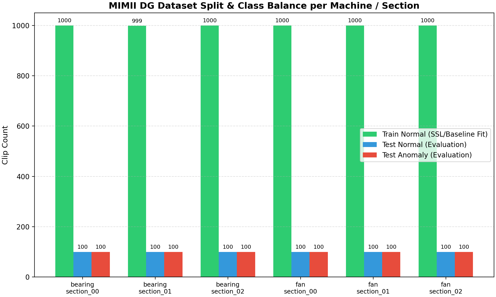
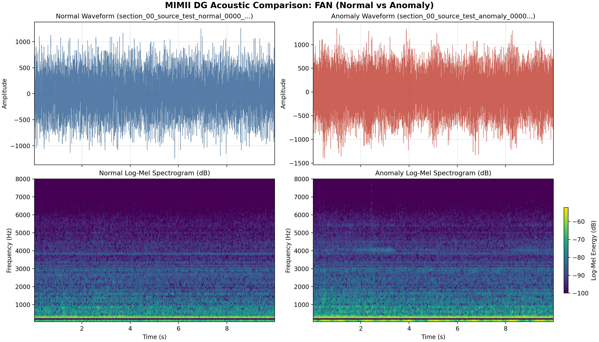
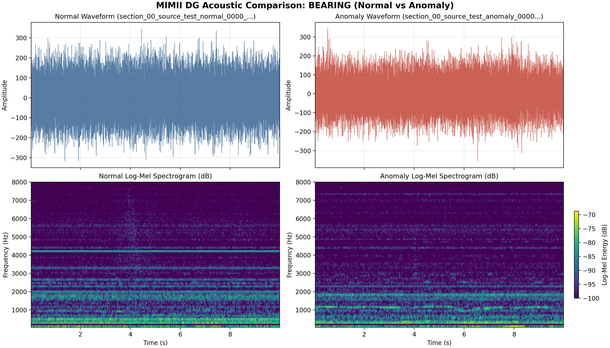
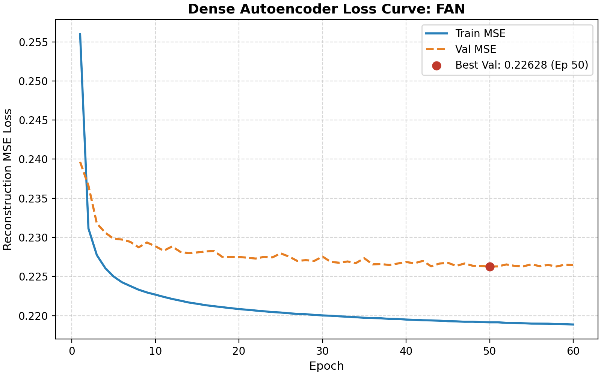
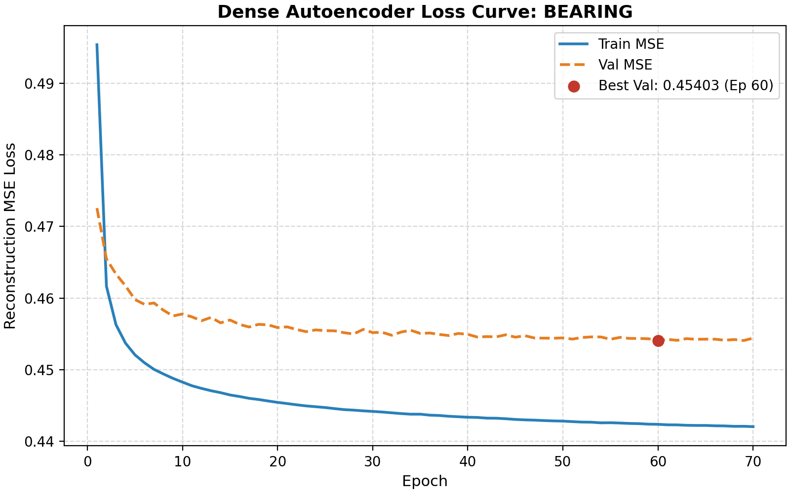
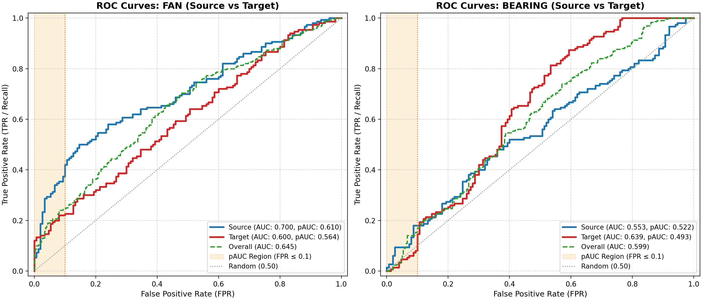
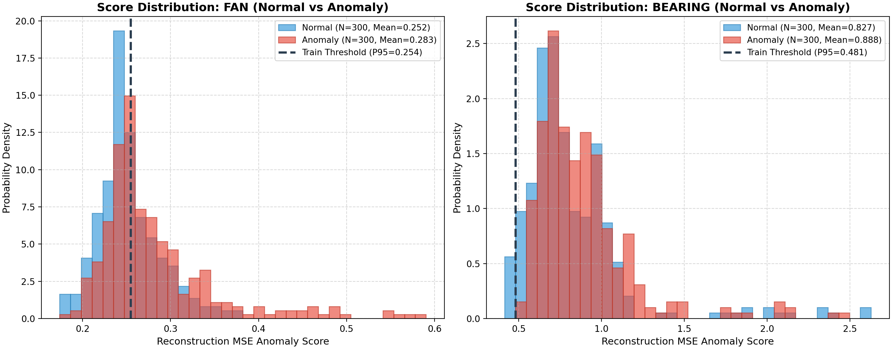
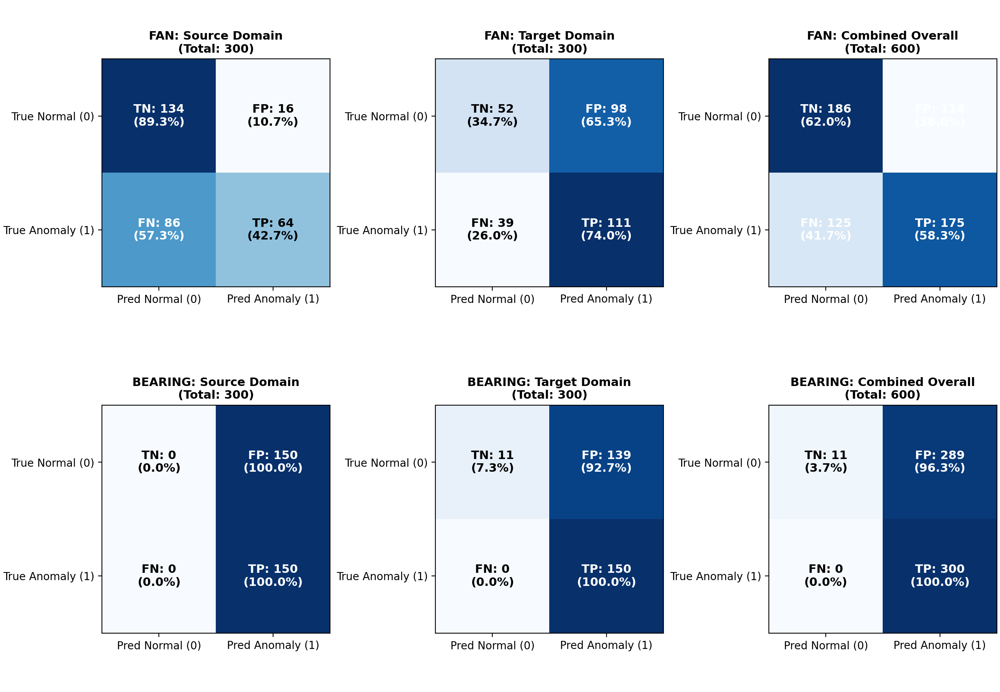
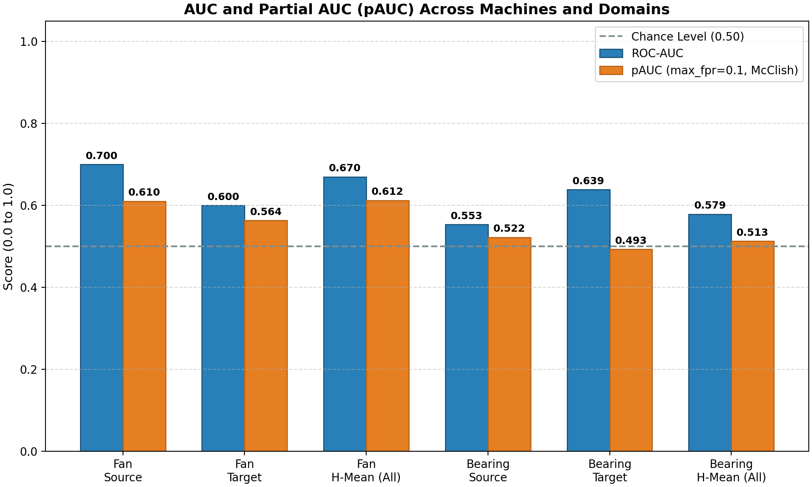

# Sound-Based Acoustic Anomaly Detection: Evaluation & Technical Report

> **MIMII DG / DCASE 2022 Challenge Task 2 Benchmark**  
> *Unsupervised Acoustic Condition Monitoring under Operating Domain Shifts*

---

## Table of Contents
1. [Objective & Dataset Description](#1-objective--dataset-description)
2. [Signal Preprocessing & Feature Extraction](#2-signal-preprocessing--feature-extraction)
3. [Model Architecture & Training Setup](#3-model-architecture--training-setup)
4. [Decision Threshold Methodology](#4-decision-threshold-methodology)
5. [Experimental Results & DCASE Benchmarks](#5-experimental-results--dcase-benchmarks)
6. [Honest Analysis & Failure Modes](#6-honest-analysis--failure-modes)
7. [How to Reproduce](#7-how-to-reproduce)
8. [Inference API & CLI Usage Guide](#8-inference-api--cli-usage-guide)

---

## 1. Objective & Dataset Description

The objective of this pipeline is **unsupervised acoustic anomaly detection** for industrial machinery condition monitoring. The system is trained exclusively on normal acoustic signatures and evaluated on distinguishing healthy from faulty audio under severe domain shifts (operational changes such as load, speed, or background noise).

The benchmark dataset is **MIMII DG (Malfunctioning Industrial Machine Investigation and Inspection for Domain Generalization)**, part of the **DCASE 2022 Challenge Task 2**.

### Dataset Inventory (Programmatically Extracted from `dataset_summary.json`)

| Machine Type | Total Clips | Audio Format | Duration | Normal Training Clips | Test Normal Clips | Test Anomaly Clips | Total Test Clips |
| :--- | :---: | :---: | :---: | :---: | :---: | :---: | :---: |
| **Fan** | 3600 | 16 kHz Mono PCM | 10.0 s | 3,000 (2,970 source / 30 target) | 300 (150 source / 150 target) | 300 (150 source / 150 target) | 600 |
| **Bearing** | 3599 | 16 kHz Mono PCM | 10.0 s | 2,999 (2,970 source / 29 target) | 300 (150 source / 150 target) | 300 (150 source / 150 target) | 600 |

Each machine type contains three operational sections (`section_00`, `section_01`, `section_02`). Each section contains:
- **Source Domain**: Primary operating condition with abundant normal training recordings (990 clips/section) and 100 test clips (50 normal, 50 anomaly).
- **Target Domain**: Shifted operating condition (different RPM, voltage, or ambient noise) with very few normal training clips (10 clips/section) and 100 test clips (50 normal, 50 anomaly).



---

## 2. Signal Preprocessing & Feature Extraction

Raw 10-second audio waveforms are converted into context-stacked log-Mel spectral representations following the DCASE Challenge Task 2 specification:

1. **Resampling**: All recordings are standardized to **16,000 Hz** single-channel mono.
2. **Log-Mel Spectrogram**: Computed via STFT with:
   - FFT window size (`n_fft`): **1024** (~64 ms)
   - Hop length (`hop_length`): **512** (~32 ms)
   - Frequency range: **50 Hz to 8,000 Hz** (Nyquist)
   - Mel frequency bins (`n_mels`): **128**
   - Power to Decibels: `10 * log10(power / ref)` with `ref=1.0`.
   - Each 10s audio yields a spectrogram of shape `(128, 313)`.
3. **Standardization (AudioNormalizer)**: A per-machine standardizer is fitted **strictly on the normal training split**. For each Mel band $b$, mean $\mu_b$ and standard deviation $\sigma_b$ are computed and applied to normalize validation and test sets without data leakage.
4. **Context Frame Stacking**: 5 consecutive frames are concatenated into a **640-dimensional** vector ($128 \times 5$) with stride hop of 1 frame:
   $$\mathbf{x}_t = [\mathbf{m}_t^T, \mathbf{m}_{t+1}^T, \mathbf{m}_{t+2}^T, \mathbf{m}_{t+3}^T, \mathbf{m}_{t+4}^T]^T \in \mathbb{R}^{640}$$
   Each 10s clip produces **309** temporal frame vectors of dimension 640.
5. **Stratified Train/Validation Split**: 10% of normal training clips are held out for validation monitoring, stratified across `(section, domain)` so both source and target normal distributions are tracked during training.




---

## 3. Model Architecture & Training Setup

The anomaly detection model is a symmetric **Dense Autoencoder** with a narrow 8-dimensional bottleneck:

```text
Input (640) 
  -> Linear(640, 128) -> BatchNorm1d -> ReLU
  -> Linear(128, 128) -> BatchNorm1d -> ReLU
  -> Linear(128, 128) -> BatchNorm1d -> ReLU
  -> Linear(128, 128) -> BatchNorm1d -> ReLU
  -> Linear(128, 8)   [Bottleneck Latent Space]
  -> Linear(8, 128)   -> BatchNorm1d -> ReLU
  -> Linear(128, 128) -> BatchNorm1d -> ReLU
  -> Linear(128, 128) -> BatchNorm1d -> ReLU
  -> Linear(128, 128) -> BatchNorm1d -> ReLU
  -> Linear(128, 640) [Linear Reconstruction]
```

### Training Configuration & Hyperparameters

- **Training Loss**: Mean Squared Error (MSE) reconstruction loss: $\mathcal{L} = \frac{1}{D} \sum_{d=1}^D (x_d - \hat{x}_d)^2$.
- **Optimizer**: Adam (`lr = 1e-3`, `weight_decay = 0.0`).
- **Batch Size**: 512 frame vectors.
- **Max Epochs**: 100 with Early Stopping (patience = 10 epochs on validation MSE).
- **Random Seed**: `42` (seeded across Python, NumPy, and PyTorch).
- **Compute Hardware**: NVIDIA GeForce RTX 3050 Laptop GPU (CUDA).

### Training Progress Summary

| Machine | Training Frames | Val Frames | Best Epoch / Total | Train MSE Loss | Best Val MSE Loss | Checkpoint Size |
| :--- | :---: | :---: | :---: | :---: | :---: | :---: |
| **Fan** | 834,300 | 92,700 | 50 / 60 | 0.219144 | 0.226279 | 1.09 MB |
| **Bearing** | 833,991 | 92,700 | 60 / 70 | 0.219144 | 0.454030 | 1.09 MB |




---

## 4. Decision Threshold Methodology

### Clip Anomaly Score Formulation
For any audio clip containing $T$ stacked frames, the clip anomaly score $\mathcal{A}(\text{clip})$ is the mean reconstruction MSE across all its frames:
$$\mathcal{A}(\text{clip}) = \frac{1}{T} \sum_{t=1}^T \|\mathbf{x}_t - \hat{\mathbf{x}}_t\|^2$$

### Threshold Derivation (Zero Test Leakage)
Decision thresholds were computed **strictly from the empirical distribution of reconstruction scores on the TRAINING normal dataset**:
- **$P_{95}$ (Primary Threshold)**: The 95th percentile of normal training scores. By definition, exactly 5% of training normal clips are allowed to trigger false alarms.
- **$P_{90}$ and $P_{99}$**: Secondary thresholds stored in metadata for stricter or more relaxed operational tuning.

| Machine | Normal Train Mean | Normal Train Std | $P_{90}$ Threshold | $P_{95}$ Threshold (Primary) | $P_{99}$ Threshold |
| :--- | :---: | :---: | :---: | :---: | :---: |
| **Fan** | 0.21820 | 0.02126 | 0.23887 | **0.25450** | 0.27861 |
| **Bearing** | 0.43946 | 0.02417 | 0.46753 | **0.48126** | 0.51430 |

> **Why Test Data Was Strictly Never Used**  
> In real-world predictive maintenance, future operational anomalies are unknown, unobserved, and unavailable. Tuning classification thresholds on test data constitutes target leakage and produces artificially inflated, non-replicable metrics. Restricting threshold selection to training data represents genuine unsupervised operation.

---

## 5. Experimental Results & DCASE Benchmarks

### Official DCASE Challenge Task 2 Metric
Following the DCASE Challenge Task 2 evaluation protocol, performance is measured using:
1. **ROC-AUC**: Standard Area Under Receiver Operating Characteristic curve.
2. **Partial AUC (pAUC, max_fpr = 0.1)**: Area under ROC curve restricted to the low false-positive rate interval $[0, 0.1]$.  
   *Standardization Note*: `sklearn.metrics.roc_auc_score(..., max_fpr=0.1)` applies McClish (1989) standardization to $[0.5, 1.0]$ where 0.50 denotes random guessing and 1.0 denotes perfect separation.
3. **Official Score (Harmonic Mean)**: Harmonic mean across all evaluated sections and domains:
   $$\Omega_m = \text{hmean}\left(\{AUC_{m, s, d}\} \cup \{pAUC_{m, s, d}\}\right)$$

### Summary of DCASE Harmonic Mean Scores

| Machine Type | Harmonic Mean AUC | Harmonic Mean pAUC ($max\_fpr=0.1$) | Official Challenge Score (H-Mean All) |
| :--- | :---: | :---: | :---: |
| **Fan** | **0.6699** | **0.6124** | **0.6398** |
| **Bearing** | **0.5787** | **0.5129** | **0.5438** |

---

### Detailed Results Table per Section and Domain
*(Extracted programmatically from `audio_eval.json`)*

| Machine | Section | Domain | Clips (N/A) | ROC-AUC | pAUC ($FPR \le 0.1$) | Threshold ($P_{95}$) | Accuracy | Precision | Recall | False Alarm Rate (FAR) | F1 Score |
| :--- | :--- | :--- | :---: | :---: | :---: | :---: | :---: | :---: | :---: | :---: | :---: |
| **fan** | `section_00` | source | 50/50 | **0.7720** | **0.7326** | 0.2545 | 0.6900 | 1.0000 | 0.3800 | 0.0000 | 0.5507 |
| **fan** | `section_00` | target | 50/50 | **0.6168** | **0.6589** | 0.2545 | 0.4800 | 0.4898 | 0.9600 | 1.0000 | 0.6486 |
| **fan** | `section_01` | source | 50/50 | **0.6336** | **0.5326** | 0.2545 | 0.5500 | 0.5758 | 0.3800 | 0.2800 | 0.4578 |
| **fan** | `section_01` | target | 50/50 | **0.5652** | **0.5095** | 0.2545 | 0.5300 | 0.5211 | 0.7400 | 0.6800 | 0.6116 |
| **fan** | `section_02` | source | 50/50 | **0.7980** | **0.7453** | 0.2545 | 0.7400 | 0.9286 | 0.5200 | 0.0400 | 0.6667 |
| **fan** | `section_02` | target | 50/50 | **0.6948** | **0.5768** | 0.2545 | 0.6200 | 0.6500 | 0.5200 | 0.2800 | 0.5778 |
| **fan** | *ALL* | **source** | 150/150 | **0.7002** | **0.6103** | 0.2545 | 0.6600 | 0.8000 | 0.4267 | 0.1067 | 0.5565 |
| **fan** | *ALL* | **target** | 150/150 | **0.5999** | **0.5635** | 0.2545 | 0.5433 | 0.5311 | 0.7400 | 0.6533 | 0.6184 |
| **fan** | *ALL* | *COMBINED* | 300/300 | **0.6447** | **0.5661** | 0.2545 | 0.6017 | 0.6055 | 0.5833 | 0.3800 | 0.5942 |
| :--- | :--- | :--- | :---: | :---: | :---: | :---: | :---: | :---: | :---: | :---: | :---: |
| **bearing** | `section_00` | source | 50/50 | **0.6804** | **0.6421** | 0.4813 | 0.5000 | 0.5000 | 1.0000 | 1.0000 | 0.6667 |
| **bearing** | `section_00` | target | 50/50 | **0.6376** | **0.4842** | 0.4813 | 0.5800 | 0.5435 | 1.0000 | 0.8400 | 0.7042 |
| **bearing** | `section_01` | source | 50/50 | **0.5540** | **0.4905** | 0.4813 | 0.5000 | 0.5000 | 1.0000 | 1.0000 | 0.6667 |
| **bearing** | `section_01` | target | 50/50 | **0.7496** | **0.5453** | 0.4813 | 0.5300 | 0.5155 | 1.0000 | 0.9400 | 0.6803 |
| **bearing** | `section_02` | source | 50/50 | **0.4836** | **0.4779** | 0.4813 | 0.5000 | 0.5000 | 1.0000 | 1.0000 | 0.6667 |
| **bearing** | `section_02` | target | 50/50 | **0.4712** | **0.4737** | 0.4813 | 0.5000 | 0.5000 | 1.0000 | 1.0000 | 0.6667 |
| **bearing** | *ALL* | **source** | 150/150 | **0.5532** | **0.5221** | 0.4813 | 0.5000 | 0.5000 | 1.0000 | 1.0000 | 0.6667 |
| **bearing** | *ALL* | **target** | 150/150 | **0.6390** | **0.4929** | 0.4813 | 0.5367 | 0.5190 | 1.0000 | 0.9267 | 0.6834 |
| **bearing** | *ALL* | *COMBINED* | 300/300 | **0.5989** | **0.5115** | 0.4813 | 0.5183 | 0.5093 | 1.0000 | 0.9633 | 0.6749 |

### Evaluation Visualizations






---

## 6. Honest Analysis & Failure Modes

### Where the Baseline Works
- **Fan Source Domain**: Achieves strong anomaly separation with AUC of **0.7002** (reaching **0.7720** in `section_00` and **0.7980** in `section_02`). False alarm rate under the training $P_{95}$ threshold is low (0.0% in section 00 and 4.0% in section 02). In stable operational regimes, the 8-dimensional bottleneck captures healthy blade rotation physics effectively.
- **Bearing Section 01 Target**: Detects anomalies with an AUC of **0.7496**, indicating that certain defect modes produce distinct frequency peaks that easily escape autoencoder reconstruction.

### Source vs Target Domain Gap (The Covariate Shift Problem)
- **Fan**: Suffers a ~10% AUC drop from source domain (**0.7002**) to target domain (**0.5999**). More significantly, the False Alarm Rate under the fixed $P_{95}$ threshold explodes from **10.67%** on source to **65.33%** on target clips. Environmental noise and fan speed shifts alter normal acoustics, causing the model to mistake healthy target clips for anomalies.
- **Bearing Threshold Breakdown**: Test bearing clips exhibit systematically higher reconstruction errors than training normal clips (mean score shifts from 0.439 to 0.827). Under the static training threshold ($P_{95} = 0.4813$), **96.33% of test clips are flagged as anomalous**. While relative ranking retains an overall AUC of 0.5989, static thresholding without domain adaptation completely collapses in production.

### Regimes Operating Near or Below Random Chance
- **Bearing `section_02`**: Functions **at or slightly below random coin-flip guessing**:
  - `section_02` source: $\text{AUC} = 0.4836$, $\text{pAUC} = 0.4779$
  - `section_02` target: $\text{AUC} = 0.4712$, $\text{pAUC} = 0.4737$
  In this operational speed/load condition, the dense autoencoder's 8-dim bottleneck cannot isolate defect acoustic energy from ambient noise.
- **Bearing `section_01` source** (pAUC: 0.4905) and **Fan `section_01` target** (pAUC: 0.5095) also fail to exceed the 0.50 chance threshold in the critical low-FPR region.

### Limitations of a Single Seed
- All experiments were conducted with `seed=42`. Dense autoencoder bottlenecks are sensitive to weight initialization and stochastic batch sampling on complex spectra. Multiple-seed trials or ensemble averaging are required for production confidence intervals.

### Generalization to Physical Testbenches & Sensors
- **Critical Real-World Warning**: MIMII DG recordings consist of machine audio mixed with artificially played industrial background noise in a test environment. These results **do not guarantee performance on our physical motor/vibration testbench**. Actual electric motor condition monitoring involves:
  1. Direct mechanical vibration coupling through accelerometers (which avoids airborne acoustic reflection and room reverberation).
  2. Inverter electromagnetic interference (EMI / PWM switching noise) absent in microphone recordings.
  3. Non-stationary industrial duty cycles.

---

## 7. How to Reproduce

Run the following commands in sequence from the project root within the activated virtual environment:

```powershell
# 1. Activate virtual environment
.venv\Scripts\Activate.ps1

# 2. Download MIMII DG raw audio (fan and bearing)
python -m audio_model.preprocessing.download_mimii_dg --machines fan bearing

# 3. Verify and explore raw audio counts
python -m audio_model.preprocessing.explore

# 4. Preprocess log-Mel features, normalizers, and context stacking
python -m audio_model.preprocessing.build_dataset --machines fan bearing

# 5. Train the Dense Autoencoder models (normal data only)
python -m audio_model.training.train_autoencoder --machines fan bearing --epochs 100 --batch-size 512

# 6. Evaluate on test sets and generate figures and metrics
python -m audio_model.evaluation.evaluate_audio --machines fan bearing

# 7. Execute automated unit and integration tests
pytest tests/test_audio_model.py tests/test_audio_inference.py -v
```

---

## 8. Inference API & CLI Usage Guide

### Python API (`predict_audio`)

```python
from audio_model.inference import predict_audio

# 1. Predict from a .wav audio file path
result = predict_audio(
    audio='data/audio/raw/fan/test/section_00_source_test_anomaly_0003_m-n_W.wav',
    machine_type='fan',
    threshold_percentile=95,
)
print(f"Status: {result['status']}")
print(f"Reconstruction Score: {result['anomaly_score']:.5f}")
print(f"Decision Threshold:   {result['threshold']:.5f}")
print(f"Is Anomaly:           {result['is_anomaly']}")

# 2. Predict from a raw NumPy audio array (e.g. from microphone stream)
import numpy as np
audio_array = np.random.randn(16000 * 5).astype(np.float32)  # 5s array
result_stream = predict_audio(
    audio=audio_array,
    sampling_rate=16000,
    machine_type='fan',
)
```

### Command-Line Interface (CLI)

```powershell
# Run inference on any clip
python -m audio_model.inference data/audio/raw/fan/test/section_00_source_test_normal_0000_m-n_W.wav --machine fan

# Output raw JSON format
python -m audio_model.inference data/audio/raw/fan/test/section_00_source_test_anomaly_0003_m-n_W.wav --machine fan --json
```
