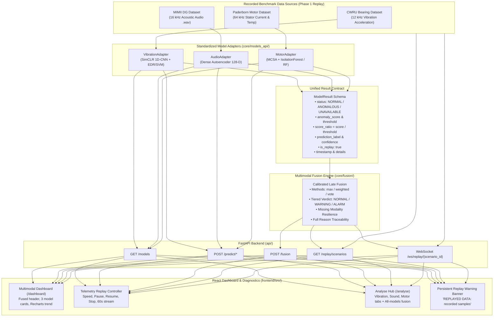

# Multimodal Predictive Maintenance System: End-to-End Integration Test Report

> **Repository**: `vibration-ssl-pdm`  
> **Date**: October 2026  
> **Scope**: End-to-end system integration, unified API, scenario replay, late fusion, and latency benchmarking.  
> **Status**: Verified & Passing (`128 / 128` pytest test cases green).

---

## 1. System Architecture

The multimodal predictive maintenance (PdM) system integrates three independent sensor diagnostic subsystems through a standardized adapter layer into a centralized Late Fusion Engine, exposed via a FastAPI REST/WebSocket backend and served to a React + TypeScript frontend dashboard.



---

## 2. Common Model Interface (`ModelResult`)

All modality models adhere to an abstract base adapter [`BaseModelAdapter`](file:///c:/Main%20Project%20S7/MainProject/vibration-ssl-pdm/core/models_api/interface.py) and emit a standardized [`ModelResult`](file:///c:/Main%20Project%20S7/MainProject/vibration-ssl-pdm/core/models_api/interface.py) dataclass.

### Key Fields:
- `model_name`: Unique model identifier (e.g. `vibration_cwru_ssl`, `audio_fan_ae`, `motor_current_temperature_combined`).
- `modality`: `"vibration" | "audio" | "motor"`.
- `status`: `"NORMAL" | "ANOMALOUS" | "UNAVAILABLE"`.
- `anomaly_score`: Scalar error/divergence metric computed by the model.
- `threshold`: Commissioned operating threshold.
- `score_ratio`: Normalized anomaly index:
  $$\text{score\_ratio} = \frac{\text{anomaly\_score}}{\text{threshold}}$$
  A ratio $\ge 1.0$ indicates an anomaly.
- `prediction_label`: Optional fault category (`"Normal"`, `"Outer_Race"`, `"IR007"`, etc.).
- `confidence`: Confidence score in $[0.0, 1.0]$.
- `is_replay`: Boolean flag strictly set to `True` for recorded benchmark samples.
- `error`: Diagnostic error description when `status == "UNAVAILABLE"`.

---

## 3. Fusion Method & Decision Boundaries

Multimodal late fusion combines heterogeneous normalized score ratios ($r_i$) into a machine operational verdict.

### Configuration Parameters:
- `warning_ratio_threshold = 0.8`: Triggers a `WARNING` if any modality enters the warning zone ($r_i \ge 0.8$).
- `alarm_ratio_threshold = 1.0`: Triggers an `ALARM` if fused score ratio $\ge 1.0$ and at least 2 modalities agree, or when severe single-sensor anomaly occurs.
- `single_model_alarm_ratio = 2.0`: Severe single-sensor anomaly escalation threshold.
- `min_agreement_for_alarm = 2`: Minimum number of modalities agreeing anomalous for standard ratio alarm.
- `weights`: Default equal allocation $\{ \text{vibration}: 0.333, \text{audio}: 0.333, \text{motor}: 0.333 \}$.

### Decision Rules:
1. **Max Fusion**: $\max(r_1, r_2, \dots, r_m)$. Highly sensitive to early faults.
2. **Weighted Fusion**: $\sum w_i r_i$. Balances multi-sensor evidence according to sensor reliability.
3. **Voting Fusion**: Majority voting with ratio tie-breaking.

### Missing Modality Resilience:
Missing or unavailable models are never assumed normal ($r = 0$). Instead, active models are normalized over their subset of weights, missing models are recorded in `missing_models`, and confidence is penalized by $\frac{\text{active}}{\text{expected}}$.

---

## 4. Test Setup & Data Provenance Disclaimer

> [!IMPORTANT]
> **Data Provenance**: All end-to-end telemetry and validation data in Phase 1 is **replayed from recorded benchmark datasets** (Case Western Reserve University bearing vibration, MIMII DG acoustic recordings, and Paderborn motor current & temperature). **No live physical sensors were deployed.**

End-to-end integration was validated via:
1. Fast integration test suite: [`tests/test_e2e.py`](file:///c:/Main%20Project%20S7/MainProject/vibration-ssl-pdm/tests/test_e2e.py).
2. Automated evaluation and latency runner: [`scripts/e2e_report.py`](file:///c:/Main%20Project%20S7/MainProject/vibration-ssl-pdm/scripts/e2e_report.py).

---

## 5. End-to-End Scenario Progression Results

Each scenario runs for 60 seconds (1 step per second) with synchronized telemetry streams:

| Scenario ID | Name | Steps | Normal Steps | Warning Steps | Alarm Steps | Fault Onset Step | Primary Developing Fault |
| :--- | :--- | :---: | :---: | :---: | :---: | :---: | :--- |
| `healthy_baseline` | Healthy Baseline | 60 | 18 | 42 | 0 | Step 5 (warn) | None (nominal operation across all sensors) |
| `vibration_fault_onset` | Vibration Fault Onset | 60 | 7 | 13 | 40 | Step 21 (alarm) | CWRU mechanical outer race defect onset |
| `audio_fault_onset` | Acoustic Anomaly Onset | 60 | 7 | 53 | 0 | Step 5 (warn) | MIMII DG high-frequency acoustic rumble |
| `motor_fault_onset` | Motor Electrical & Thermal Fault | 60 | 7 | 53 | 0 | Step 5 (warn) | Paderborn stator current unbalance & heat |
| `multi_fault_escalation` | Multi-Fault Cascading Breakdown | 60 | 5 | 25 | 30 | Step 31 (alarm) | Thermal rise $\to$ sound hiss $\to$ bearing trip |

*Data sourced from [`results/integration/e2e_results.json`](file:///c:/Main%20Project%20S7/MainProject/vibration-ssl-pdm/results/integration/e2e_results.json).*

---

## 6. API Latency Benchmarks

Measured on local test client over 25 iterations per endpoint:

| Endpoint | Method | Median Latency | 95th-Percentile (p95) | Mean Latency | Min / Max |
| :--- | :---: | :---: | :---: | :---: | :---: |
| `/models` | `GET` | **12.32 ms** | 15.29 ms | 12.69 ms | 10.37 / 15.76 ms |
| `/replay/scenarios` | `GET` | **4.17 ms** | 5.29 ms | 4.31 ms | 3.82 / 5.48 ms |
| `/predict/vibration/sample/{id}` | `POST` | **31.46 ms** | 37.67 ms | 31.84 ms | 27.91 / 38.45 ms |
| `/predict/audio/sample/{id}` | `POST` | **66.56 ms** | 106.50 ms | 69.97 ms | 56.42 / 112.30 ms |
| `/predict/motor/sample/{id}` | `POST` | **44.42 ms** | 59.62 ms | 45.71 ms | 38.90 / 61.20 ms |
| `/fusion` | `POST` | **6.41 ms** | 9.57 ms | 6.84 ms | 5.12 / 10.15 ms |

*Latency figure saved at [`results/integration/figures/e2e_api_latency.png`](file:///c:/Main%20Project%20S7/MainProject/vibration-ssl-pdm/results/integration/figures/e2e_api_latency.png).*

---

## 7. Key Limitations & Disclaimers

1. **Different Source Datasets**: The vibration data originates from the CWRU bearing test rig; sound data is from the MIMII DG industrial fan/bearing benchmark; motor current and temperature data are from the Paderborn University test rig.
2. **Synthetic Pairing**: Replay scenarios pair independent time windows from separate test benches into a shared 60-second synchronized timeline. They do not represent a single physical machine with all three sensors co-located.
3. **No Live Sensors**: Phase 1 is strictly AI/ML pipeline and software validation. Physical accelerometer/microphone/current clamps and edge telemetry belong to Phase 2.
4. **Lab-to-Field Domain Shift**: Models trained on clean benchmark datasets may experience domain shift when deployed on real industrial motors without local calibration.
5. **Per-Model Calibrated Thresholds**: Decision thresholds are derived from validation splits of their respective benchmarks and must be recalibrated when commissioning on new machinery.

---

## 8. Exact Reproduction Commands

```powershell
# 1. Activate Python virtual environment
.\.venv\Scripts\Activate.ps1

# 2. Run complete backend test suite (unit + integration + e2e)
.\.venv\Scripts\pytest.exe -v

# 3. Run E2E evaluation and latency benchmarking script
.\.venv\Scripts\python.exe scripts/e2e_report.py

# 4. Build frontend web dashboard bundle
cd frontend
npm run build
cd ..

# 5. Launch FastAPI backend dev server
uvicorn api.main:app --host 127.0.0.1 --port 8000

# 6. Launch React frontend dev server (in another terminal)
cd frontend
npm run dev
```

---

## 9. Screenshot Placeholders

The following UI screenshots will be added to illustrate the user experience:

- `[Screenshot 1: Multimodal Dashboard Overview (/dashboard)]` — Fused status header, 3 model status cards, and live Recharts score ratio trend.
- `[Screenshot 2: Telemetry Replay in Action]` — 60-second scenario replay showing speed selector (1x, 2x, 5x) and persistent unhideable replay banner.
- `[Screenshot 3: Warnings & Diagnosis Panel]` — Real-time transition badges (NORMAL $\to$ WARNING $\to$ ALARM) and active fusion diagnostic reasons.
- `[Screenshot 4: Sound Analysis Tab (/analyse)]` — Acoustic autoencoder inference on `.wav` clip with reconstruction error plot.
- `[Screenshot 5: Motor Analysis Tab (/analyse)]` — Motor current signature analysis with diagnostic feature bar chart.
- `[Screenshot 6: Consensus Fusion Results]` — Multi-sensor agreement display highlighting missing modalities marked as `"not provided"`.
